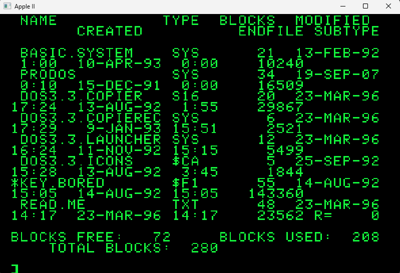
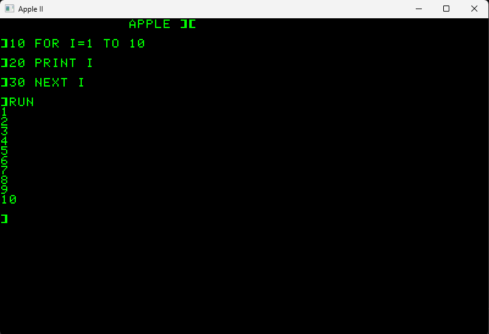
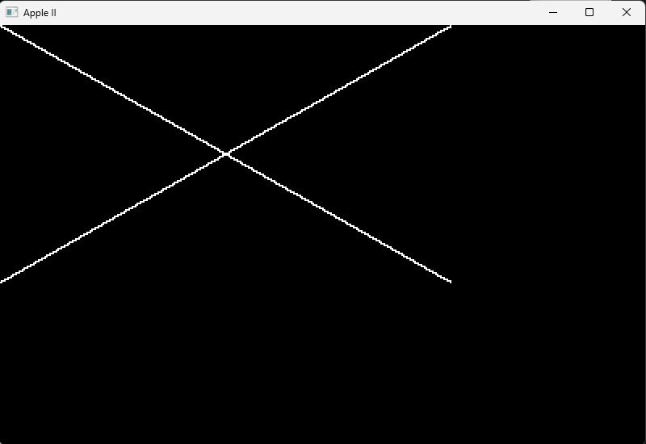

# apple2-odin

An Apple II emulator written from scratch in [Odin](https://odin-lang.org/).

> **Source code is currently private while the project is in its early
> development stages.**
>
> This repository documents the project, its progress and its goals.

## About the project

This project started as a personal challenge: learn Odin, rediscover the
Apple II from the inside, and understand how an emulator actually works by
building one step at a time.

I have known and used the Apple II for about 40 years.

Building an emulator is turning out to be a surprisingly good way to discover
how much I still didn't know about it.

In a way, I knew this machine for forty years.

I'm now discovering that I didn't know it nearly as well as I thought.

The project is intentionally developed incrementally, usually in small
sessions of around one hour.

The objective is not to build an emulator as quickly as possible, but to
understand the machine while building it.

**The journey is really the point.**

## Current status

The emulator can now boot both the original Apple II ROM and a real ProDOS
system from a `.dsk` disk image.

ProDOS BASIC 1.8 reaches its command prompt through the emulated Disk II
controller, and filesystem access is operational: `CATALOG` successfully reads
and displays the directory of the mounted disk.



*ProDOS BASIC 1.8 reading the directory of a real `.dsk` image through the
emulated Disk II controller.*

The original Apple II ROM also continues to run Applesoft BASIC interactively
in an SDL3 window.



*The original Apple II ROM running Applesoft BASIC interactively in
apple2-odin. The BASIC program, keyboard handling, execution and text output
are all handled by the emulated machine.*

For example, programs can be entered and executed directly:

```basic
]10 FOR I = 1 TO 10
]20 PRINT I
]30 NEXT I
]RUN
1
2
3
4
5
6
7
8
9
10
]
```

The display is rendered using the original Apple II character generator ROM
(341-0036), including normal, inverse and flashing characters.

The emulator is already using original Apple II hardware mechanisms such as
the keyboard soft switches and the video soft switches from $C050 to $C057.

Lo-Res graphics are now rendered directly from Apple II video memory in 16
colors, including mixed graphics/text mode. Applesoft BASIC can use `GR`,
`COLOR=`, `PLOT`, `HLIN` and `VLIN` to draw through the emulated machine.

Hi-Res graphics now include a first digital approximation of the Apple II's
artifact colors. The renderer decodes the original 280×192 Hi-Res memory layout,
supports PAGE1/PAGE2 and mixed mode, and interprets the phase bit, absolute pixel
parity and neighboring pixels to produce black, white, green, purple, blue and
orange. Applesoft `HGR`, `HCOLOR=` and `HPLOT` all render through emulated video
memory.

The SDL3 frontend now renders the Apple II in its native **280×192 logical
coordinate space**. SDL3 handles presentation to the host window adaptively,
preserving the original aspect ratio while keeping Apple II pixel coordinates
independent from display scaling.



The Disk II model now includes two independent drives, motor control, drive
selection, Q6/Q7, physical head movement in quarter-track units, CPU-cycle-driven
rotation and a controller data latch. Real `.dsk` images can be loaded and
nibblized into Disk II tracks.

That path is now complete enough to boot ProDOS BASIC 1.8 and read the mounted
filesystem through the emulated Disk II controller.

The NMOS 6502 core currently implements **all 151 official opcode variants**.

## What is already working

- NMOS 6502 CPU emulation
- All 151 official NMOS 6502 opcode variants
- CPU registers, flags and stack
- Multiple 6502 addressing modes
- NMOS 6502 indirect JMP page-boundary behavior
- Apple II memory and bus
- ROM loading and RESET vector handling
- Boot of a real Apple II ROM
- Applesoft BASIC
- Apple II keyboard soft switches
- Interactive PC keyboard input
- 40×24 Apple II text display
- Original Apple II character generator ROM
- Normal, inverse and flashing text
- PAGE1 / PAGE2 video selection
- Apple II video soft switches ($C050-$C057)
- TEXT / GRAPHICS, FULL / MIXED, PAGE1 / PAGE2 and LORES / HIRES selection
- 40×48 Apple II Lo-Res graphics
- 16-color Lo-Res rendering
- Mixed Lo-Res graphics with four text rows at the bottom
- Applesoft Lo-Res graphics commands rendering through emulated video memory
- 280×192 Apple II Hi-Res graphics
- Hi-Res PAGE1 / PAGE2 addressing
- Mixed Hi-Res graphics with four text rows at the bottom
- Applesoft `HGR`, `HCOLOR=` and `HPLOT` rendering through emulated Hi-Res memory
- Hi-Res artifact-color approximation: green, purple, blue and orange
- Hi-Res phase-bit and absolute pixel-parity decoding
- Neighbor-aware Hi-Res decoding for white and artifact colors
- Native 280×192 logical rendering independent from host display scaling
- Adaptive SDL3 presentation with aspect-ratio-preserving letterboxing
- Initial Disk II controller state
- Slot 6 Disk II soft switches (`$C0E0-$C0EF`)
- Disk II stepper phases, motor control, drive selection and Q6/Q7
- Disk II quarter-track head positioning driven by phase transitions
- Disk II head movement limits and bidirectional stepping
- CPU instruction cycle reporting for peripheral timing
- Independent rotational state for both Disk II drives
- CPU-cycle-driven Disk II rotation
- Disk II track-byte positioning and wraparound
- Disk II controller data latch fed by the selected rotating drive
- DOS 3.3 `.dsk` image loading
- 35-track / 16-sector / 256-byte sector image representation
- DOS 3.3 sector ordering
- Disk II 4-and-4 address encoding
- Disk II 6-and-2 data encoding and checksum
- Complete address and data fields with synchronization gaps
- 6,250-byte nibblized track generation
- Nibblization of all 35 tracks from a real disk image
- Disk insertion and ejection with media-owned track storage
- Real nibblized disk bytes reaching the controller data latch through CPU-cycle-driven rotation
- ProDOS sector ordering
- Language Card RAM and bank switching
- ProDOS boot through the emulated Disk II controller
- ProDOS BASIC 1.8
- ProDOS filesystem access (`CATALOG` verified)
- SDL3 interactive frontend
- Native Windows and macOS / Apple Silicon builds
- BASIC program execution and screen scrolling

## Architecture

The emulation core is deliberately kept independent from the host frontend.

```text
Physical keyboard
       │
       ▼
      SDL3
       │
       ▼
+------------------+
|     Apple II     |
|                  |
| Memory / Bus     |
| ROM              |
| Keyboard I/O     |
| Video state      |
| Video rendering  |
+--------+---------+
         │
         ▼
+------------------+
|       6502       |
|                  |
| Registers        |
| Instructions     |
| Addressing modes |
| Flags / Stack    |
+------------------+
```

The 6502 core does not know that it is running inside an Apple II, and the
Apple II emulation contains no SDL-specific logic.

Keeping these layers separate should make other frontends and platforms
possible later.

That separation has now been validated on a second host platform: on
September 16, 2026, the emulator was built and run natively on an Apple Silicon
M5 Mac without any change to the emulation core. Development can now move
between Windows and macOS.

## Milestone #1 — From nothing to "HI"

The first milestone was getting enough of the 6502 running to execute a small
program and produce recognizable output.

```text
HI
```

It wasn't much.

But it was the first time the CPU I was building actually did something
recognizable.

## Milestone #2 — From "HI" to "APPLE ]["

The next major milestone was very different.

The emulator reached the point where it could start executing the original
Apple II ROM from its RESET vector.

Eventually, this appeared:

```text
APPLE ][
```

This time I didn't write the message.

**The original Apple II ROM did.**

Soon afterwards, the Applesoft prompt appeared and the machine became
interactive.

That was the point where the project started to feel less like a CPU
experiment and more like an Apple II.

## Authentic Apple II text

The initial SDL frontend deliberately used a temporary host-side debug font.

It has since been replaced by rendering based on the original Apple II
character generator ROM (341-0036).

The emulator now decodes the character stored in Apple II text memory,
determines its display attribute and renders the corresponding character ROM
bitmap.

Normal, inverse and flashing characters are supported.

Text PAGE1 and PAGE2 selection is also part of the emulated machine state and
can be controlled through the original Apple II soft switches at `$C054` and
`$C055`.

## Where it goes next

With **all 151 official NMOS 6502 opcode variants implemented** and ProDOS now
booting successfully through the emulated Disk II controller, the project has
moved beyond the first complete disk-boot milestone.

The next major hardware and compatibility steps include:

- improving Disk II head-position and read behavior
- further Disk II controller accuracy
- validating DOS 3.3 boot and compatibility
- further CPU timing and ~1 MHz synchronization work
- speaker
- joystick / paddles
- broader real-software compatibility testing

The exact order may change as real software continues to expose missing pieces
of the machine.

## The next big milestone

One of the first major goals is to boot **DOS 3.3** and run a real Apple II
assembler such as **Merlin**.

The moment I can:

```text
Boot DOS 3.3
      │
      ▼
Run Merlin
      │
      ▼
Write 6502 code
      │
      ▼
Assemble it
      │
      ▼
Run it on the emulated Apple II
```

will be an important milestone.

At that point, the emulator will no longer just run software.

It will be able to run the tools used to **create Apple II software**.

## Compatibility targets

The first major game compatibility target is:

### Choplifter

The objective is not merely to reach the title screen.

The objective is to make it **playable**.

After that, some of the programs and games I would particularly like to use
as compatibility targets include:

- DROL
- Spare Change
- Karateka
- Aztec
- Airheart

**Airheart is the long-term stress test.**

If this emulator eventually runs Airheart correctly, a lot of things will
have gone right along the way.

## Development journal

This project is as much about the journey as the final emulator.

Rather than only documenting finished features, I want to keep some of the
small discoveries, mistakes and unexpected moments that happen while building
the machine.

Not every development session will appear here.

Only the moments worth remembering.

### September 2, 2026 — BASIC finds a missing opcode

By this point, the emulator could boot the original Apple II ROM and run
Applesoft BASIC interactively.

I wanted a slightly better screenshot for this README, so instead of simply
typing `?1+1`, I entered a small BASIC program:

```basic
10 FOR I = 1 TO 10
20 PRINT I
30 NEXT I
RUN
```

And the emulator stopped.

Applesoft had encountered opcode `$FD`.

`$FD` is `SBC Absolute,X`, one of the official 6502 opcode variants I had not
implemented yet.

This was a small moment, but a satisfying one.

Instead of implementing an instruction because a checklist said it was
missing, real Apple II software had just told me what it needed next.

I implemented `$FD` and ran exactly the same program again.

This time:

```text
1
2
3
4
5
6
7
8
9
10
]
```

The screenshot at the top of this README is the result.

**A screenshot intended to document the emulator had actually helped improve
the emulator.**

This is increasingly how I want to build it: let real software push the
machine forward and teach me which details matter.

### September 7, 2026 — The JSR that never existed

While implementing NMOS 6502 decimal mode, the same BASIC program that had
helped uncover the missing `$FD` opcode suddenly stopped working again.

This time the emulator eventually crashed on an unknown opcode in RAM.

The obvious suspect was the new decimal-mode implementation.

So I started tracing.

The trace led to something strange: Applesoft appeared to execute:

    JSR $F4F0

That looked suspicious, but `$F4F0` was a perfectly valid address inside the
original Apple II ROM. The code there executed normally for a while before
eventually returning to nonsense in RAM.

For some time, the investigation went through decimal ADC, SBC, the stack,
JSR, RTS and PLA.

All of them turned out to be innocent.

The real Apple II ROM contained this:

    D572  70 04     BVS $D578
    D574  C9 20     CMP #$20
    D576  F0 F4     BEQ $D56C

A recent refactoring of `BVS` had accidentally caused its relative offset to
be fetched twice.

That single extra byte changed everything.

The `$C9` opcode was skipped, leaving the `$20` operand of `CMP #$20` to be
interpreted as an opcode.

And `$20` happens to be `JSR`.

The next two bytes were `$F0 $F4`.

So the emulator saw:

    20 F0 F4

and quite correctly executed:

    JSR $F4F0

The most misleading part was that `$F4F0` really did contain valid Apple II
ROM code. Instead of crashing immediately, the emulator wandered into a real
ROM routine, executed plausible instructions, and only failed later.

The decimal-mode implementation had nothing to do with it.

One relative branch had simply consumed its operand twice.

It was a good reminder that while building an emulator, the most interesting
bugs are not always the ones that immediately break the machine.

Sometimes a bug creates a perfectly plausible machine that never existed.

### September 8, 2026 — 151 out of 151

On a train to Paris, with a couple of hours ahead of me, it felt like the
perfect time to finish the 6502.

The last two official NMOS 6502 opcodes missing from the emulator were
`BRK` and `RTI`.

They were a fitting pair to finish with, because implementing them was not
just a matter of adding two entries to the opcode table.

I built a small test that executed `BRK`, followed the IRQ/BRK vector,
checked the return address and processor status pushed onto the stack,
executed `RTI`, and verified that execution resumed at exactly the right
address.

It worked.

With that, the emulator now implements **all 151 official NMOS 6502 opcode
variants**.

That does not mean the CPU is finished. Timing is not cycle accurate yet,
and there are still NMOS 6502 edge cases to verify.

But one chapter is complete.

### September 10, 2026 — Making the 6502 a little more 6502

With all 151 official NMOS 6502 opcode variants implemented, the next step
was not adding instructions, but making the CPU behave a little more like
the original silicon.

One famous NMOS 6502 quirk is the indirect `JMP` page-boundary bug.

For `JMP ($12FF)`, a normal 16-bit read would fetch the low byte from `$12FF`
and the high byte from `$1300`.

The NMOS 6502 does not.

It reads the high byte from `$1200` instead.

I added a dedicated indirect `JMP` word reader to reproduce that behavior,
then tested both the normal and page-boundary cases:

```text
JMP ($1234) -> $5678
JMP ($12FF) -> $5634
```

While checking the other indirect addressing modes, I discovered that their
Zero Page wraparound behavior was already correctly implemented.

No new opcode today.

Just a slightly more authentic 6502.

## First Hi-Res graphics

Hi-Res turned out to be a very different step from Lo-Res.

An Apple II Hi-Res page occupies 8 KB, but its 192 scanlines are not stored
consecutively. The address of a scanline is built from different groups of bits
in the vertical coordinate, producing the characteristic interleaved Apple II
memory layout.

Each byte contributes seven visible pixels, giving a logical resolution of
280×192. For the first implementation, bit 7 and composite artifact color are
deliberately ignored: the goal was first to validate the memory layout and pixel
decoder in monochrome.

The first test wrote `$7F` directly to `$2000`, producing seven white pixels at
the top-left of the screen. The same path was then tested from Applesoft:

```basic
HGR
POKE 8192,127
```

That worked too.

The next test was more interesting:

```basic
HGR
HPLOT 0,0
```

The screen remained black.

A targeted CPU and memory trace showed that Applesoft was reaching the correct
Hi-Res address and executing its plotting routine correctly. The final write to
`$2000` was simply writing `$00`.

The emulator was not broken.

Applesoft was drawing in black.

With an explicit color:

```basic
HGR
HCOLOR=3
HPLOT 0,0 TO 279,159
HPLOT 0,159 TO 279,0
```

the first real Hi-Res image appeared: two white diagonals crossing the graphics
area.

The complete path is now:

```text
Applesoft HGR / HCOLOR= / HPLOT
        -> Applesoft ROM
        -> emulated 6502
        -> Apple II bus / Hi-Res RAM
        -> Hi-Res address decoder
        -> seven-pixel byte decoder
        -> SDL3
```

As with Lo-Res, the frontend is not drawing a synthetic approximation of the
result. Applesoft itself modifies the emulated Apple II video memory, and the
renderer interprets that memory.

Sometimes a black screen means the emulator is broken.

Sometimes the Apple II is simply drawing black. :)

## Hi-Res artifact color

The monochrome Hi-Res renderer proved that the memory layout and seven-pixel
byte decoder were correct.

The next step was the part that makes Apple II graphics much more interesting:
color.

Apple II Hi-Res memory does not store a conventional color value for each
pixel. Bits 0-6 of each byte represent seven pixel positions, while bit 7 shifts
the color phase. The apparent color also depends on the pixel's absolute
horizontal position and on neighboring pixels.

The first implementation deliberately models this digitally rather than trying
to simulate the complete NTSC composite signal:

```text
phase 0 -> purple / green
phase 1 -> blue / orange
adjacent lit pixels -> white
unlit pixels -> black
```

One architectural rule became important very quickly: the Apple II video layer
needs to work with **logical Apple II coordinates**, while SDL only needs scaled
host coordinates.

The distinction sounds obvious in retrospect.

It was not obvious enough in the first version.

The renderer initially calculated:

```odin
x := (col * 7 + bit) * PIXEL_SCALE
```

and passed that same `x` to the artifact-color decoder.

With `PIXEL_SCALE = 2`, every value of `x` was even.

That meant the emulator could never see an odd Apple II pixel position.

Purple and blue appeared.

Green and orange did not.

The bug became obvious while copying the renderer code for discussion. The fix
was simply to keep the two coordinate systems separate:

```odin
pixel_x := col * 7 + bit
x := pixel_x * PIXEL_SCALE
```

`pixel_x` is used by the Apple II color logic.

`x` is used by SDL.

That small distinction immediately brought back both missing artifact colors.

The phase information itself also comes from bit 7 of the Hi-Res byte:

```odin
phase_shift := (hires_value & 0x80) != 0
```

and neighboring lit pixels are used to produce white.

The result was validated from Applesoft BASIC using all eight `HCOLOR` values:

```basic
HGR
FOR C=0 TO 7
HCOLOR=C
Y=10+C*18
HPLOT 20,Y TO 120,Y
NEXT C
```

The expected families now appear: black, green, purple, white, black, orange,
blue and white.

Mixed-mode text exposed one more small rendering leak: the bottom four text
rows could inherit the last graphics color left in the SDL renderer. Text color
is now selected explicitly, keeping normal text green and mixed-mode text white.

This is still a deliberately simple artifact-color model. A real composite
display blends the underlying pixel patterns into more continuous colors, so a
future NTSC/composite renderer could go much further.

For now, though, the digital Apple II Hi-Res representation is finally producing
the colors that made the machine look the way it did.

And the debugging lesson was memorable:

**With a display scale of two, every screen coordinate was even.**

For a machine whose colors depend on odd and even pixels, that mattered. :)

## The Disk II enters the machine

The next hardware chapter has started with the Disk II controller.

Rather than beginning with disk-image formats or DOS sectors, the first step was
to model the controller as hardware owned by the Apple II. Accesses to the
standard slot 6 range `$C0E0-$C0EF` are now routed by the machine bus to the
Disk II module.

Those sixteen switches currently control the four stepper-motor phases, motor
state, selected drive and Q6/Q7:

```text
$C0E0-$C0E7  stepper phases 0-3
$C0E8-$C0E9  motor
$C0EA-$C0EB  drive selection
$C0EC-$C0EF  Q6 / Q7
```

The first tests validate the controller state and the complete bus-to-device
path.

The next step was to make those phase lines move a modeled physical head. The
head position is now stored in quarter-track units:

```text
0   = track 0.00
1   = track 0.25
2   = track 0.50
3   = track 0.75
4   = track 1.00
...
136 = track 34.00
```

Movement is derived from neighboring stepper-phase transitions rather than from
an abstract "next track" operation. Intermediate two-phase states therefore
produce quarter-track movement, and reversing the phase sequence reverses the
head direction. The current model also enforces the physical limits at positions
0 and 136.

A simple round-trip test now produces:

```text
20 -> 21 -> 22 -> 23 -> 24
24 -> 23 -> 22 -> 21 -> 20
```

through the Disk II soft switches.

That completed the mechanical head-positioning step.

The next step was to make the disk itself move.

## September 2026 — Native Apple Silicon and adaptive display

On September 16, the emulator was built and run natively on an Apple Silicon
M5 Mac for the first time.

No changes to the 6502 core or Apple II hardware model were required. Only the
host build environment and SDL3 setup needed platform-specific attention,
providing a first practical validation of the separation between the emulated
machine and its frontend.

The display path was then simplified around the Apple II's native 280×192
logical coordinate space. Text, Lo-Res and Hi-Res now render in machine
coordinates, while SDL3 is responsible for adapting that image to the host
window and preserving its aspect ratio.

This also reinforces a lesson learned during artifact-color work: Apple II
coordinates belong to the emulated machine; display scaling belongs to the
frontend.

### October 6, 2026 — The disk starts spinning


Getting here took slightly longer than expected.

Before fighting the Disk II, I first spent a fair amount of time fighting
something considerably more modern: Windows and macOS.

I wanted the same project to build and debug cleanly on both machines, with
Windows remaining my main development environment and the Mac becoming a
second native target. What sounded like a small tooling exercise turned into
the usual collection of shell differences, build paths, SDL setup, debugger
configuration and the occasional moment where the executable being debugged
was not, in fact, the executable I had just built.

Eventually, Windows and macOS agreed to coexist.

The Disk II then decided it was its turn.

What looked like a fairly innocent next step — make the disk rotate according
to CPU cycles — led through instruction timing, fractional rotational
accumulators, two independently spinning drives, controller latches, media
ownership, pointer semantics and, for good measure, a Windows stack overflow
caused by accidentally putting half a megabyte of disk tracks inside every
local Apple II instance.

At some point, making a 1977 floppy-disk controller work started to feel easier
than making two computers from 2026 agree on how to build it.

But eventually both battles were won.


The 6502 `step()` function now reports the number of cycles consumed by each
instruction. Those cycles are passed to the Disk II, where an integer
accumulator converts elapsed CPU time into movement through the encoded track:

```text
6502 instruction
    -> elapsed CPU cycles
    -> Disk II rotation
    -> track byte position
    -> byte passing under the head
```

The current model uses approximately 204,600 CPU cycles per 300 RPM revolution
and 6,250 encoded bytes per track revolution. Fractional progress is preserved
between instructions, avoiding floating-point timing and cumulative rounding
loss.

Both drives have independent mechanical state. They can therefore rotate at the
same time, regardless of which one is selected. Drive selection determines
which rotating medium is connected to the controller.

A data latch now sits between the selected drive and the Apple II bus. When
rotation advances to a new byte under the selected head, that byte is loaded
into the latch. CPU reads expose the latch rather than directly inspecting the
track.

A synthetic two-drive test demonstrates the distinction:

```text
before: drive1=1234 drive2=2234 latch=$D5
after : drive1=1235 drive2=2235 latch=$AA
```

Both disks advanced. Drive 2 reached `$AB`, but because drive 1 was selected,
only drive 1's `$AA` reached the controller latch.

This work also exposed an architectural issue. Embedding every track directly
inside each drive made a local `AppleII` instance more than half a megabyte and
caused a Windows stack overflow. Track storage is now referenced separately and
will be allocated only when media is inserted. A `nil` track pointer naturally
represents an empty drive.

There is still no real `.dsk` image in the drive.

But the path now exists:

```text
CPU cycles
    -> rotating disk
    -> selected drive
    -> byte under the head
    -> controller data latch
    -> Apple II bus
    -> CPU
```

The next step is no longer to teach the drive how to move.

It is to give it a disk.

Preferably without another stack overflow. :)

### October 7, 2026 — Giving the drive a disk

The drive now has one.

A standard DOS 3.3 `.dsk` image is 143,360 bytes: 35 tracks, 16 sectors per
track and 256 bytes per sector. The emulator can now load that image and turn
its sector data into the encoded byte stream expected on a Disk II track.

That conversion includes:

```text
.dsk sector data
    -> DOS 3.3 sector ordering
    -> 4-and-4 address encoding
    -> address fields
    -> 6-and-2 data encoding
    -> data fields and checksum
    -> synchronization gaps
    -> 6,250-byte nibblized track
```

The first real sector read from the image was track 0, sector 0. Its first
bytes looked reassuringly like 6502 boot code:

```text
01 38 B0 03 4C 32 A1 86 43 C9 03 08 8A 29 70 4A
```

Address fields use the familiar Disk II prologue:

```text
D5 AA 96
```

and data fields begin with:

```text
D5 AA AD
```

The 256 bytes of sector data are transformed through 6-and-2 encoding into the
disk-safe byte values used by the controller. Address fields, data fields and
gaps are then assembled into a complete 6,250-byte rotational track.

The same process is applied to all 35 tracks.

Media ownership is now explicit as well. An empty drive has no track storage.
Inserting a disk allocates and builds the nibblized tracks; ejecting it releases
them and returns the drive to an empty state.

The satisfying test was connecting this new media path to the rotational model
from the previous step.

With a real DOS 3.3 image inserted, drive 1 selected, the head on track 0 and
the motor switched on through `$C0E9`, CPU-cycle-driven rotation moved through
the initial synchronization bytes.

Then the controller latch saw:

```text
position 48 -> $D5
position 49 -> $AA
position 50 -> $96
```

The address-field prologue had reached the controller.

This time those bytes were not placed manually into a synthetic test track.
They came from a real `.dsk` image, passed through sector ordering and
nibblization, were mounted in the drive, rotated under the head according to
elapsed CPU cycles, and finally reached the data latch.

The path is now:

```text
DOS 3.3 .dsk
    -> sectors
    -> nibblized tracks
    -> inserted media
    -> Disk II rotation
    -> read head
    -> controller data latch
    -> Apple II bus
```

The drive finally has a disk.

The next question is whether DOS agrees. :)

### October 12, 2026 — The Disk II finally boots something

Getting bytes from a disk image to the controller was one thing.

Getting an operating system to believe it was talking to a real Disk II
turned out to be something else entirely.

The first attempt looked promising. The Apple II boot ROM found the controller,
the disk started spinning, sectors were being read, and execution moved well
beyond the initial boot code.

Then it failed.

What followed was several days of tracing increasingly deep layers of the
machine.

At various points, the investigation went through:

- the Disk II boot ROM
- 6-and-2 encoding
- sector ordering
- the 6502 stack and JSR/RTS behavior
- CPU instruction timing
- the Disk II data latch
- the Language Card
- ProDOS memory probing and relocation
- code executing from bank-switched RAM
- and finally the Disk II controller test itself

Several things that looked suspicious turned out to be perfectly correct.

One particularly memorable example was an apparent jump into `$0080`.
For a moment it looked like CPU execution had gone completely wrong.

It had not.

The original code really was doing that.

Eventually ProDOS got far enough to print:

```text
RELOCATION / CONFIGURATION ERROR
```

That was actually good news.

It meant a surprising amount of the machine was already working.

The trace eventually reached a small loop repeatedly reading the Disk II
controller at `$C0EC`. The disk was rotating and the controller was being
accessed, but ProDOS never observed the change it expected.

The reason turned out to be a tiny assumption in my own model.

I represent Disk II head position in quarter-track units. Until now, the read
path only returned disk data when the head was positioned exactly on a whole
track:

```text
head_position % 4 == 0
```

During the ProDOS controller test, the emulated stepper had left the head at
position 29.

Track 7 is position 28.

So the head was only one quarter-track away, the disk was spinning normally,
but my emulator simply declared that position unreadable.

Every read therefore looked the same to ProDOS.

Removing that restriction was enough to change the result dramatically.

The next boot produced:

```text
PRODOS BASIC 1.8
COPYRIGHT APPLE 1983-92
]
```

And then came the test I really wanted to see:

```text
]CATALOG
```

The directory appeared.


*ProDOS BASIC 1.8 reading the directory of a real `.dsk` image through the
emulated Disk II controller.*

That was probably the most satisfying moment of the Disk II work so far.

The first version of the drive had grown from a few soft switches into
stepper phases, quarter-track positioning, rotational timing, two independent
drives, a controller latch, real `.dsk` images, sector ordering, 6-and-2
nibblization, a Language Card, and finally enough controller behavior for
ProDOS to boot and read its filesystem.

The quarter-track behavior is still an approximation and will need refinement.

But for the first time, a real operating system has successfully booted from
my emulated Disk II.

The drive finally has a disk.

And now the Apple II can actually use it. :)

## October 2026 — From a spinning drive to a bootable disk

During the first half of October, the Disk II model crossed an important
boundary: it stopped operating only on synthetic track data, gained real disk
media, and became complete enough to boot ProDOS.

CPU instruction timing drives independent rotational state for both drives,
while the selected drive feeds the controller through a data latch. Real
`.dsk` images can be converted into nibblized tracks with address fields,
6-and-2 data encoding, checksums and synchronization gaps.

Disk media also has an explicit lifecycle: inserting an image allocates and
builds its track representation, while ejecting it releases that media again.

The complete path now reaches from a real disk image to a running operating
system:

```text
.dsk image
    -> sector data
    -> nibblized tracks
    -> rotating media
    -> read head
    -> controller data latch
    -> Apple II bus
    -> 6502
    -> ProDOS
    -> filesystem
```

ProDOS BASIC 1.8 now boots successfully, and `CATALOG` reads and displays the
directory of the mounted disk.

## Longer-term goals

The current focus is the original Apple II architecture and NMOS 6502.

The architecture is intended to leave room for:

- Apple IIe
- auxiliary memory
- 80-column mode
- 65C02
- Apple IIc

Portability is also a long-term objective, with native Windows and macOS /
Apple Silicon builds now working.

Current and potential platforms include:

- Windows — working
- macOS / Apple Silicon — working
- Linux
- Web / WebAssembly

iOS / iPadOS may eventually become a separate frontend project.

For now, getting the Apple II itself right takes priority.

## Why Odin?

[Odin](https://odin-lang.org/) is a low-level systems programming language
with a pleasantly C-like feel.

It has turned out to be a particularly enjoyable fit for an emulator:
explicit memory handling, simple data structures, little framework overhead,
and a short path between understanding a piece of Apple II hardware and
implementing it.

This project is also how I am learning the language.

So I am simultaneously learning a new programming language and rediscovering
a computer I first used decades ago.

That combination is a large part of the fun.

## First color graphics

The first Lo-Res graphics were generated by Applesoft BASIC itself rather
than by a frontend test pattern.

For example:

```basic
GR
FOR C=0 TO 15
COLOR=C
HLIN 0,39 AT C
NEXT C
```

produces 16 horizontal color bands by modifying Apple II video memory through
the emulated machine.

The path is now:

```text
Applesoft -> 6502 -> Apple II bus -> video memory -> Lo-Res decoder -> SDL3
```

That makes Lo-Res graphics another end-to-end Apple II feature rather than a
host-side approximation.

## Development philosophy

This is deliberately not a "write an emulator as fast as possible" project.

The emulator is being built incrementally, usually in small development
sessions.

Whenever possible, each step introduces one new piece of the machine while
leaving the emulator in a working state.

There is still a lot missing.

All 151 official NMOS 6502 opcode variants are implemented.

The CPU is not fully cycle accurate yet, and some NMOS 6502 edge cases still
need to be verified, but instruction execution now reports elapsed cycles for
peripheral timing.

Disk II emulation now includes two independent drives, stepper-driven
quarter-track head movement, CPU-cycle-driven rotation, track-byte positioning
and a controller data latch. Real `.dsk` images can be loaded, nibblized into
encoded tracks, inserted into a drive and read through the controller data path.

That path is now complete enough to boot ProDOS BASIC 1.8 and access the
mounted filesystem, with `CATALOG` successfully displaying the disk directory.

Lo-Res graphics and Hi-Res graphics with a first artifact-color approximation are working.

The SDL3 frontend now presents the machine from a native 280×192 logical
viewport, and the same codebase runs natively on Windows and macOS / Apple
Silicon.

And there will certainly be plenty of surprises along the way.

That's exactly why I'm building it.

## Project status

**Very experimental.**

This is a personal learning project, not yet a production-quality or
cycle-accurate Apple II emulator.

The source code remains private for now.

Progress, experiments and significant milestones will be documented here.

But it boots.

It runs BASIC.

BASIC can draw in Hi-Res color.

And now it boots ProDOS from an emulated Disk II and reads a real filesystem. :)
